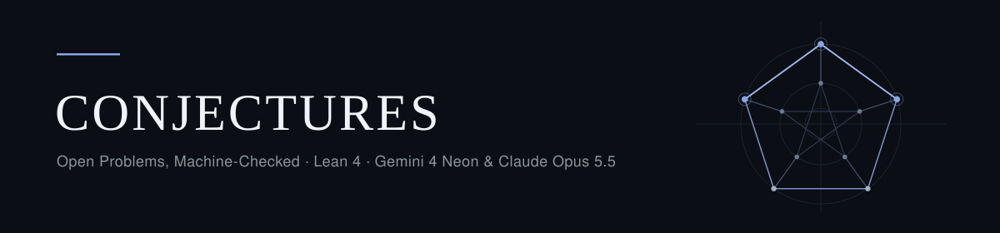
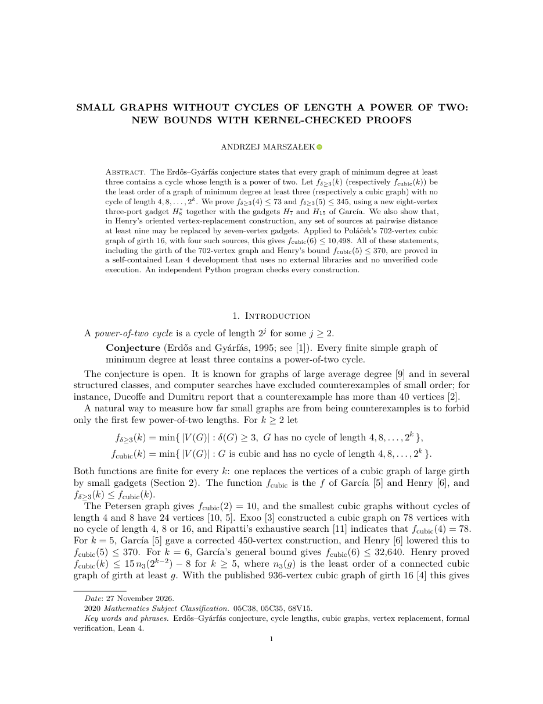
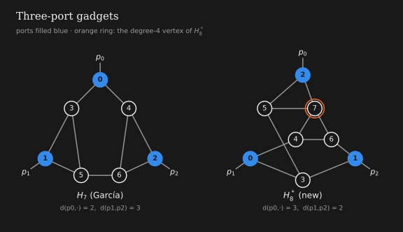
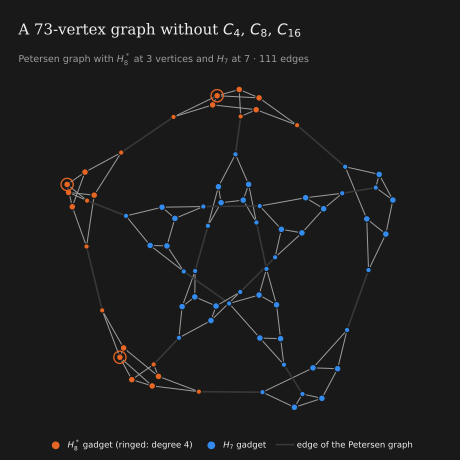
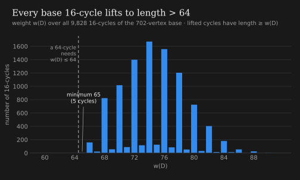

Results on open problems in mathematics, each published with a paper, a Lean 4
proof checked by the Lean kernel, an independent checker, and the data needed
to reproduce it.

**Author:** Andrzej Marszałek (Independent Researcher, ORCID
[0009-0006-6148-2965](https://orcid.org/0009-0006-6148-2965)) ·
**License:** CC0 1.0 (public domain) ·
[](https://github.com/hipotures/conjectures/actions/workflows/verify.yml)
[](https://doi.org/10.5281/zenodo.24588312)

## Catalog

| Problem | Result | Status | Category | Artifacts |
|---|---|---|:-:|---|
| [Erdős–Gyárfás](#erdősgyárfás-conjecture) | [Small graphs without cycles of length a power of two](results/small-graphs-power-of-two-cycles/) | preprint, v1.0.0 | A | [PDF](results/small-graphs-power-of-two-cycles/paper.pdf) · [TeX](results/small-graphs-power-of-two-cycles/paper.tex) · [Lean](lean/ErdosGyarfas) · [Python](results/small-graphs-power-of-two-cycles/verify.py) · [Data](results/small-graphs-power-of-two-cycles/data) |
| [Erdős–Gyárfás](#erdősgyárfás-conjecture) | Cubic bipartite graphs on at most 84 vertices contain a cycle of length 4, 8 or 16 | in preparation | B | [Lean reductions](lean/ErdosGyarfas/CubicBipartite.lean) |

**Categories.** **A**: every claim is proved by the Lean kernel; no external
computation is trusted. **B**: computer-assisted; Lean proves the reductions
and the soundness of the certificate checkers, while the exhaustive search runs
outside Lean and is reproducible from the published code.

Each result lives in its own folder under `results/`, and each problem has its
own Lean library under `lean/`. New problems are added the same way.

## Papers

<table>
<tr>
<td width="42%" valign="top"><a href="results/small-graphs-power-of-two-cycles/paper.pdf"></a></td>
<td valign="top">

### [Small graphs without cycles of length a power of two](results/small-graphs-power-of-two-cycles/paper.pdf)

Erdős–Gyárfás conjecture · category A · 9 pages ·
[v1.0.0, doi:10.5281/zenodo.24588313](https://doi.org/10.5281/zenodo.24588313)

A new eight-vertex gadget gives graphs of minimum degree 3 on **73** vertices
without cycles of length 4, 8, 16, and on **345** vertices without cycles of
length 4, 8, 16, 32 (the best cubic graphs have 78 and 370). A source-packing
theorem applied to Poláček's 702-vertex cubic graph of girth 16 gives a cubic
graph on **10,498** vertices without cycles of length 4, 8, 16, 32, 64.

Every statement, including the girth of the 702-vertex graph, is a theorem of
the Lean kernel; `#print axioms` shows only `propext`, `Classical.choice`,
`Quot.sound`.

[PDF](results/small-graphs-power-of-two-cycles/paper.pdf) ·
[TeX](results/small-graphs-power-of-two-cycles/paper.tex) ·
[Lean](lean/ErdosGyarfas) ·
[checker](results/small-graphs-power-of-two-cycles/verify.py) ·
[data](results/small-graphs-power-of-two-cycles/data) ·
[certificates](results/small-graphs-power-of-two-cycles/certificates)

</td>
</tr>
</table>

### Visual highlights

<table>
<tr>
<td width="50%" valign="top"><br>
The new gadget H8* has one more vertex than García's H7, but its port p0 is at
distance 3 from the others. A cycle entering through p0 gains an edge.</td>
<td width="50%" valign="top"><br>
The 73-vertex witness: each vertex of the Petersen graph is replaced by a
gadget. Every cycle leaving a gadget is longer than 16.</td>
</tr>
<tr>
<td width="50%" valign="top"><br>
The only delicate case of the 10,498-vertex bound: all 9,828 base 16-cycles
have weight at least 65, so none lifts to a 64-cycle.</td>
<td width="50%" valign="top">

**How these images are made.** They are generated by
[`scripts/build_showcase.py`](scripts/build_showcase.py) from the paper's PDF,
the data extracted from the Lean sources, and the independent checker, so they
always show the committed results.

</td>
</tr>
</table>

---

## Erdős–Gyárfás conjecture

> **Conjecture (Erdős–Gyárfás, 1995).** Every finite simple graph with minimum
> degree at least 3 contains a cycle whose length is a power of two.

`f_δ≥3(k)` and `f_cubic(k)` denote the least order of a graph with minimum
degree at least 3 (respectively, a cubic graph) that has no cycle of length
4, 8, …, 2^k.

| Bound | Previous | Lean theorem | Notes |
|---|---|---|---|
| f_δ≥3(4) ≤ **73** | 78 (cubic; Exoo, Ripatti) | `f_delta3_4_le_73`, `f_delta3_4_le_73_alt` | new gadget H8\* |
| f_δ≥3(5) ≤ **345** | 370 (cubic; Henry 2026) | `f_delta3_5_le_345` | new |
| f_cubic(6) ≤ **10,498** | 10,522 (Henry 2026, conditional) | `f_cubic_6_le_10498` | source-packing theorem; girth of the 702-vertex base proved in Lean |
| f_cubic(5) ≤ 370 | Henry 2026 (first) | `f_cubic_5_le_370` | independent rediscovery; formal proof |
| f_cubic(4) ≤ 78 | Exoo | `f_cubic_4_le_78` | formal proof of a known bound |

The cycle-projection lemma for gadget lifts and the gadgets H7 and H15 are due
to García (2026) and Henry (2026); this repository formalizes them. All
category-A witnesses are proved 2-connected.

---

## Verification

Every push runs [`verify.yml`](.github/workflows/verify.yml):

1. **Kernel build.** `lake build` checks every proof (Lean 4.36.0, no Mathlib,
   about a minute).
2. **Axiom audit.** [`scripts/check_axioms.py`](scripts/check_axioms.py) runs
   `#print axioms` over [`lean/Audit.lean`](lean/Audit.lean) and accepts only
   `propext`, `Classical.choice`, `Quot.sound`.
3. **Forbidden constructs.** [`scripts/check_forbidden.py`](scripts/check_forbidden.py)
   rejects `sorry`, `native_decide`, `implemented_by`, `extern` and `axiom` in
   code.
4. **Independent checks.** Each result's `verify.py` rebuilds the constructions
   from data extracted from the Lean sources and checks them with separately
   written code.

To reproduce locally:

```bash
cd lean && lake build && cd ..
python3 scripts/check_axioms.py
python3 scripts/check_forbidden.py
python3 results/small-graphs-power-of-two-cycles/verify.py
```

## Use of AI

These results were obtained with substantial help from AI systems, mainly
Gemini 4 Neon (Google) and Claude Opus 5.5 (Anthropic), working through the
Antigravity and Claude Code tools. AI systems are not authors. Category-A
statements are checked by the Lean kernel. The author takes responsibility for
the statements, their attribution, and their presentation.

## Citation

See [`CITATION.cff`](CITATION.cff). Tagged releases are archived on Zenodo with
a DOI.
