Results on open problems in mathematics. Each one is published with a paper,
the code and data needed to reproduce it, and an independent check; how much of
it is proved by the Lean kernel is stated by its category (below).

**Author:** Andrzej Marszałek (Independent Researcher, ORCID
[0009-0006-6148-2965](https://orcid.org/0009-0006-6148-2965)) ·
**License:** CC0 1.0 (public domain), except code adapted from MIT-licensed work, which keeps its MIT license ([details](results/cubic-bipartite-power-of-two-cycles/src/LICENSE)) ·
[](https://github.com/hipotures/conjectures/actions/workflows/verify.yml)
[](https://doi.org/10.5281/zenodo.24588312)

## Catalog

| Problem | Result | Status | Category | Artifacts |
|---|---|---|:-:|---|
| [Erdős–Gyárfás](#erdősgyárfás-conjecture) | [Small graphs without cycles of length a power of two](results/small-graphs-power-of-two-cycles/) | preprint, v1.0.0 | A | [PDF](results/small-graphs-power-of-two-cycles/paper.pdf) · [TeX](results/small-graphs-power-of-two-cycles/paper.tex) · [Lean](lean/ErdosGyarfas) · [Python](results/small-graphs-power-of-two-cycles/verify.py) · [Data](results/small-graphs-power-of-two-cycles/data) |
| [Erdős–Gyárfás](#erdősgyárfás-conjecture) | [Cubic bipartite graphs on at most 88 vertices have a cycle of length 4, 8 or 16](results/cubic-bipartite-power-of-two-cycles/) | preprint, v1.2.0 | B | [PDF](results/cubic-bipartite-power-of-two-cycles/paper.pdf) · [TeX](results/cubic-bipartite-power-of-two-cycles/paper.tex) · [Lean](lean/ErdosGyarfas/CubicBipartite.lean) · [C++](results/cubic-bipartite-power-of-two-cycles/src) · [Python](results/cubic-bipartite-power-of-two-cycles/independent_check.py) · [Data](results/cubic-bipartite-power-of-two-cycles/data) |
| [Erdős–Gyárfás](#erdősgyárfás-conjecture) | [Cycles of length 4, 8, 16 and 32 in censuses of cubic graphs](results/cubic-census-power-of-two-cycles/) | preprint, v1.2.0 | C | [PDF](results/cubic-census-power-of-two-cycles/paper.pdf) · [TeX](results/cubic-census-power-of-two-cycles/paper.tex) · [C++](results/cubic-census-power-of-two-cycles/src) · [Python](results/cubic-census-power-of-two-cycles/check_witnesses.py) · [Data](results/cubic-census-power-of-two-cycles/data) |
| [Erdős–Gyárfás](#erdősgyárfás-conjecture) | [The smallest Tutte–Coxeter lifts without cycles of length 32](results/tutte-coxeter-lifts-without-32-cycles/) | preprint, v1.2.0 | B | [PDF](results/tutte-coxeter-lifts-without-32-cycles/paper.pdf) · [TeX](results/tutte-coxeter-lifts-without-32-cycles/paper.tex) · [Lean](lean/ErdosGyarfas/TutteCoxeter.lean) · [Python](results/tutte-coxeter-lifts-without-32-cycles/encode.py) · [Data](results/tutte-coxeter-lifts-without-32-cycles/data) |

**Categories.** **A**: every claim is proved by the Lean kernel; no external
computation is trusted. **B**: computer-assisted; Lean proves the reductions
and the soundness of the certificate checkers, while the exhaustive search runs
outside Lean and is reproducible from the published code. **C**: a computation
over published lists of graphs; every positive answer is an explicit object
checked by a separately written program, and no Lean is involved.

Each result lives in its own folder under `results/`, and each problem has its
own Lean library under `lean/`. New problems are added the same way.

## Papers

<table>
<tr>
<td width="42%" valign="top"><a href="results/small-graphs-power-of-two-cycles/paper.pdf"></a></td>
<td valign="top">

### [Small graphs without cycles of length a power of two](results/small-graphs-power-of-two-cycles/paper.pdf)

Erdős–Gyárfás conjecture · category A · 9 pages ·
[v1.0.0, doi:10.5281/zenodo.24588313](https://doi.org/10.5281/zenodo.24588313)

A new eight-vertex gadget gives graphs of minimum degree 3 on **73** vertices
without cycles of length 4, 8, 16, and on **345** vertices without cycles of
length 4, 8, 16, 32 (the best cubic graphs have 78 and 370). A source-packing
theorem applied to Poláček's 702-vertex cubic graph of girth 16 gives a cubic
graph on **10,498** vertices without cycles of length 4, 8, 16, 32, 64.

Every statement, including the girth of the 702-vertex graph, is a theorem of
the Lean kernel; `#print axioms` shows only `propext`, `Classical.choice`,
`Quot.sound`.

[PDF](results/small-graphs-power-of-two-cycles/paper.pdf) ·
[TeX](results/small-graphs-power-of-two-cycles/paper.tex) ·
[Lean](lean/ErdosGyarfas) ·
[checker](results/small-graphs-power-of-two-cycles/verify.py) ·
[data](results/small-graphs-power-of-two-cycles/data) ·
[certificates](results/small-graphs-power-of-two-cycles/certificates)

</td>
</tr>
<tr>
<td width="42%" valign="top"><a href="results/cubic-bipartite-power-of-two-cycles/paper.pdf">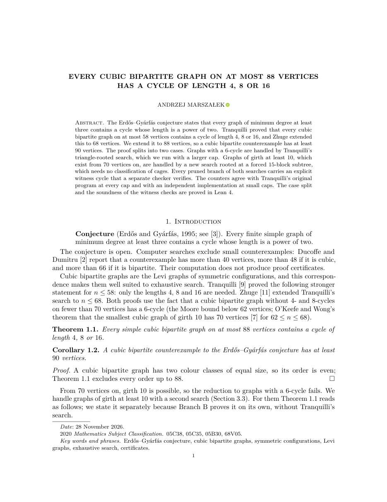</a></td>
<td valign="top">

### [Every cubic bipartite graph on at most 88 vertices has a cycle of length 4, 8 or 16](results/cubic-bipartite-power-of-two-cycles/paper.pdf)

Erdős–Gyárfás conjecture · category B · 8 pages · v1.2.0

A cubic bipartite counterexample needs at least **90** vertices (previously 60
and 70). Graphs with a 6-cycle go through Tranquilli's triangle-rooted search
at a larger cap; graphs of girth at least 10 go through a new search from a
forced 15-block root, which also shows that every cubic bipartite graph of
girth ≥ 10 on at most 88 vertices has a 16-cycle.

About 8·10¹⁰ candidate blocks at the largest cap; every rejection carries a witness cycle checked
separately. The counters match Tranquilli's original program and an
independent Python implementation; the case split and witness soundness are
proved in Lean.

[PDF](results/cubic-bipartite-power-of-two-cycles/paper.pdf) ·
[TeX](results/cubic-bipartite-power-of-two-cycles/paper.tex) ·
[how it is checked](results/cubic-bipartite-power-of-two-cycles/README.md) ·
[Lean](lean/ErdosGyarfas/CubicBipartite.lean) ·
[C++](results/cubic-bipartite-power-of-two-cycles/src) ·
[data](results/cubic-bipartite-power-of-two-cycles/data)

</td>
</tr>
<tr>
<td width="42%" valign="top"><a href="results/cubic-census-power-of-two-cycles/paper.pdf">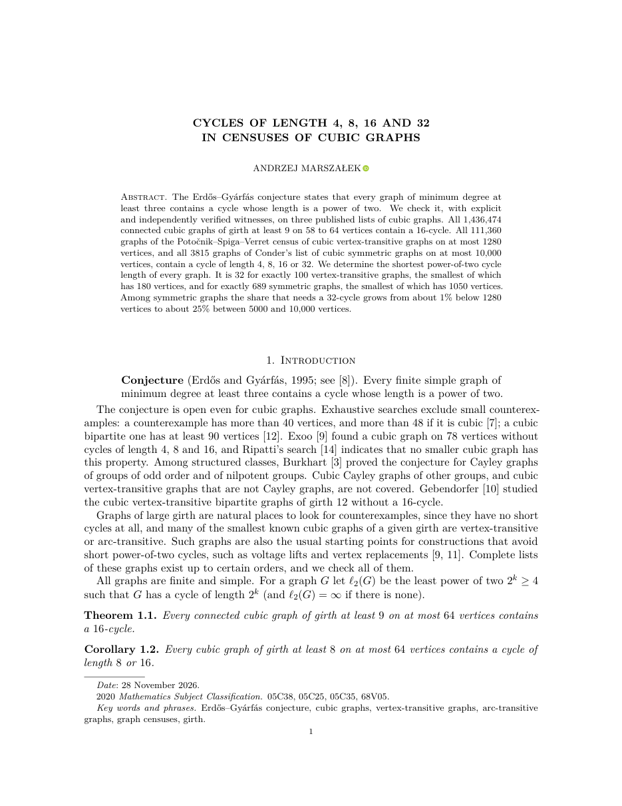</a></td>
<td valign="top">

### [Cycles of length 4, 8, 16 and 32 in censuses of cubic graphs](results/cubic-census-power-of-two-cycles/paper.pdf)

Erdős–Gyárfás conjecture · category C · 6 pages · v1.2.0

All **1,436,474** connected cubic graphs of girth ≥ 9 on 58–64 vertices have a
16-cycle. Every graph in the census of cubic vertex-transitive graphs up to
1280 vertices (**111,360** graphs) and in Conder's list of cubic symmetric
graphs up to 10,000 vertices (**3,815** graphs) has a cycle of length 4, 8, 16
or 32.

A 32-cycle is needed by 100 vertex-transitive graphs (smallest: 180 vertices)
and by 689 symmetric graphs (smallest: C1050.1). Among symmetric graphs this
share grows from 1% below 1280 vertices to 25% near 10,000. Every cycle is
checked by a separate program that reads the census files itself.

[PDF](results/cubic-census-power-of-two-cycles/paper.pdf) ·
[TeX](results/cubic-census-power-of-two-cycles/paper.tex) ·
[how it is checked](results/cubic-census-power-of-two-cycles/README.md) ·
[C++](results/cubic-census-power-of-two-cycles/src) ·
[data](results/cubic-census-power-of-two-cycles/data)

</td>
</tr>
<tr>
<td width="42%" valign="top"><a href="results/tutte-coxeter-lifts-without-32-cycles/paper.pdf">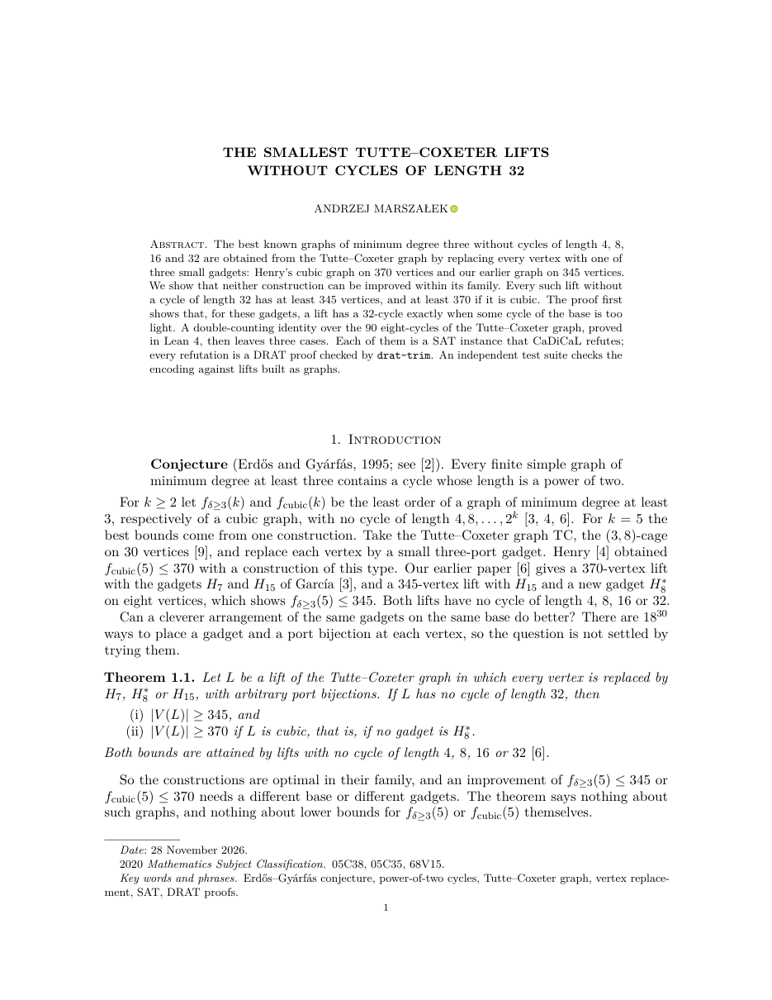</a></td>
<td valign="top">

### [The smallest Tutte–Coxeter lifts without cycles of length 32](results/tutte-coxeter-lifts-without-32-cycles/paper.pdf)

Erdős–Gyárfás conjecture · category B · 6 pages · v1.2.0

The graphs behind f_δ≥3(5) ≤ 345 and f_cubic(5) ≤ 370 replace each vertex of
the Tutte–Coxeter graph by a small gadget. Among all **18³⁰** such lifts with
the gadgets H7, H8\*, H15, none without a 32-cycle has fewer than **345**
vertices, and none of the cubic ones fewer than **370**: both constructions are
optimal in their family.

A double-counting identity over the 90 eight-cycles (proved in Lean) leaves
three cases; CaDiCaL refutes them in 58 formulas, and drat-trim checks every
proof. An independent test suite compares the encoding with 300 lifts built as
graphs.

[PDF](results/tutte-coxeter-lifts-without-32-cycles/paper.pdf) ·
[TeX](results/tutte-coxeter-lifts-without-32-cycles/paper.tex) ·
[how it is checked](results/tutte-coxeter-lifts-without-32-cycles/README.md) ·
[Python](results/tutte-coxeter-lifts-without-32-cycles) ·
[results](results/tutte-coxeter-lifts-without-32-cycles/data/results.json)

</td>
</tr>
</table>

### Visual highlights: small graphs without power-of-two cycles

<table>
<tr>
<td width="50%" valign="top"><br>
The new gadget H8* has one more vertex than García's H7, but its port p0 is at
distance 3 from the others. A cycle entering through p0 gains an edge.</td>
<td width="50%" valign="top"><br>
The 73-vertex witness: each vertex of the Petersen graph is replaced by a
gadget. Every cycle leaving a gadget is longer than 16.</td>
</tr>
<tr>
<td width="50%" valign="top"><br>
The only delicate case of the 10,498-vertex bound: all 9,828 base 16-cycles
have weight at least 65, so none lifts to a 64-cycle.</td>
<td width="50%" valign="top">

**How these images are made.** They are generated by
[`scripts/build_showcase.py`](scripts/build_showcase.py) from the paper's PDF,
the data extracted from the Lean sources, and the independent checker, so they
always show the committed results.

</td>
</tr>
</table>

### Visual highlights: cubic bipartite graphs

<table>
<tr>
<td width="50%" valign="top">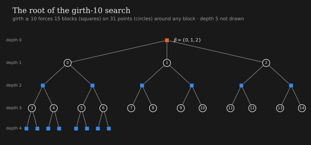<br>
Girth at least 10 forces this tree of 15 blocks on 31 points around any block,
so the girth-10 search starts from it instead of from a list of cages.</td>
<td width="50%" valign="top">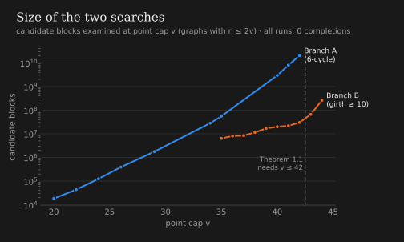<br>
Candidate blocks examined per point cap. Near the top Branch A grows about twofold per
point; at cap 44 it checks 8·10¹⁰ blocks in 39 minutes on 16 cores.</td>
</tr>
<tr>
<td width="50%" valign="top">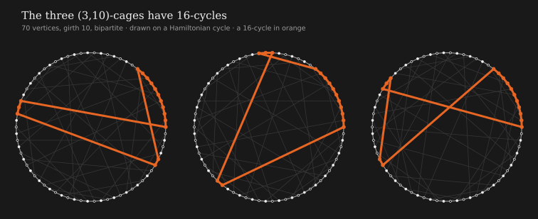<br>
The three (3,10)-cages are the smallest graphs the girth-10 search has to
reach. Each has a 16-cycle, as Theorem 1.3 requires.</td>
<td width="50%" valign="top">

**How these images are made.** Same script,
[`scripts/build_showcase.py`](scripts/build_showcase.py): the counts come from
`data/expected_counts.json`, the cages from `data/cagesk3g10.g6`, and the
16-cycles are found when the image is drawn.

</td>
</tr>
</table>

### Visual highlights: censuses of cubic graphs

<table>
<tr>
<td width="50%" valign="top">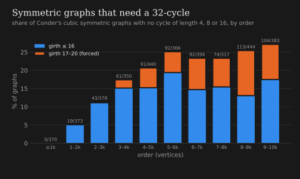<br>
Among cubic symmetric graphs, the share without cycles of length 4, 8 and 16
rises with the order. Orange: girth 17 to 20, where this is forced.</td>
<td width="50%" valign="top">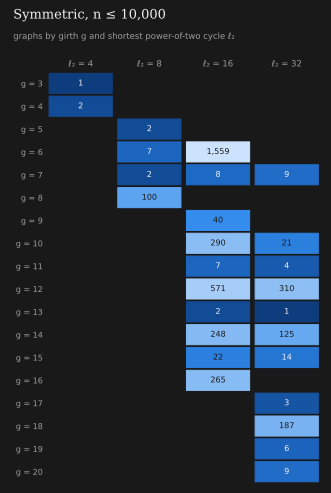<br>
Symmetric graphs up to 10,000 vertices by girth and shortest power-of-two
cycle length. No graph needs a 64-cycle.</td>
</tr>
<tr>
<td width="50%" valign="top">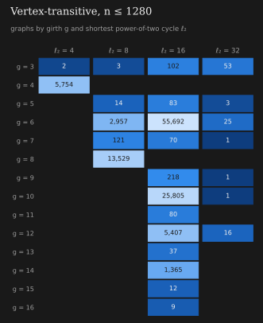<br>
Vertex-transitive graphs up to 1280 vertices. Only 100 of 111,360 need a
32-cycle; 53 of them have girth 3.</td>
<td width="50%" valign="top">

**How these images are made.** Same script, from `data/summary.json` and
`data/shortest32.tsv`, which `run_census.py` writes from the checked results.

</td>
</tr>
</table>

### Visual highlights: Tutte–Coxeter lifts

<table>
<tr>
<td width="50%" valign="top">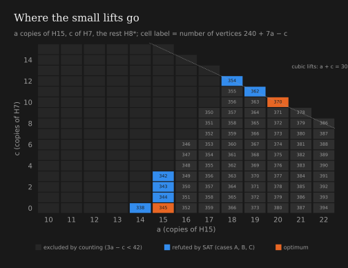<br>
Every pair (copies of H15, copies of H7) and its number of vertices. Counting
over the 90 eight-cycles rules out the dark cells; SAT with checked DRAT proofs
rules out the blue ones. Orange: the optima, 345 and 370 (cubic).</td>
<td width="50%" valign="top">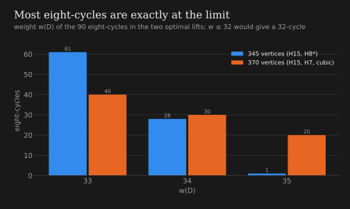<br>
In both optimal lifts most eight-cycles have weight exactly 33. The excess over
33 adds up to 30 and 70, as the counting identity 24a − 8c − 330 says it
must.</td>
</tr>
<tr>
<td width="50%" valign="top">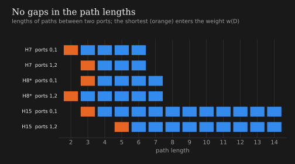<br>
Path lengths between two ports have no gaps. So a lift has a 32-cycle exactly
when some cycle of the base has weight at most 32.</td>
<td width="50%" valign="top">

**How these images are made.** Same script; the weights are computed from the
lifts in `results/small-graphs-power-of-two-cycles/data/constructions.json` and
the path lengths from the gadget edge lists.

</td>
</tr>
</table>

---

## Erdős–Gyárfás conjecture

> **Conjecture (Erdős–Gyárfás, 1995).** Every finite simple graph with minimum
> degree at least 3 contains a cycle whose length is a power of two.

`f_δ≥3(k)` and `f_cubic(k)` denote the least order of a graph with minimum
degree at least 3 (respectively, a cubic graph) that has no cycle of length
4, 8, …, 2^k.

| Bound | Previous | Lean theorem | Notes |
|---|---|---|---|
| f_δ≥3(4)&nbsp;≤&nbsp;**73** | 78 (cubic; Exoo, Ripatti) | `f_delta3_4_le_73`, `f_delta3_4_le_73_alt` | new gadget H8\* |
| f_δ≥3(5)&nbsp;≤&nbsp;**345** | 370 (cubic; Henry 2026) | `f_delta3_5_le_345` | new |
| f_cubic(6)&nbsp;≤&nbsp;**10,498** | 10,522 (Henry&nbsp;2026, conditional) | `f_cubic_6_le_10498` | source-packing theorem; girth of the 702-vertex base proved in Lean |
| f_cubic(5)&nbsp;≤&nbsp;370 | Henry 2026 (first) | `f_cubic_5_le_370` | independent rediscovery; formal proof |
| f_cubic(4)&nbsp;≤&nbsp;78 | Exoo | `f_cubic_4_le_78` | formal proof of a known bound |

The cycle-projection lemma for gadget lifts and the gadgets H7 and H15 are due
to García (2026) and Henry (2026); this repository formalizes them. All
category-A witnesses are proved 2-connected.

| Lower bound | Previous | Status | Notes |
|---|---|---|---|
| a cubic bipartite graph without C4, C8, C16 has ≥ **90** vertices | 60 (Tranquilli), 70 (Zhuge) | category B, preprint v1.2.0 | Lean: case split and witness soundness |
| a lift of the Tutte–Coxeter graph by H7, H8\*, H15 without C32 has ≥ **345** vertices (≥ **370** if cubic) | — | category B, preprint v1.2.0 | Lean: counting identity; SAT with drat-trim-checked DRAT proofs |

| Census | Graphs | Result | Status |
|---|--:|---|---|
| cubic, girth ≥ 9, 58–64 vertices | 1,436,474 | all have C16 | category C, preprint v1.2.0 |
| cubic vertex-transitive, ≤ 1280 vertices | 111,360 | all have C4, C8, C16 or C32; 100 need C32 | category C, preprint v1.2.0 |
| cubic symmetric, ≤ 10,000 vertices | 3,815 | all have C4, C8, C16 or C32; 689 need C32 | category C, preprint v1.2.0 |

---

## Verification

Every push runs [`verify.yml`](.github/workflows/verify.yml):

1. **Kernel build.** `lake build` checks every proof (Lean 4.36.0, no Mathlib,
   about a minute).
2. **Axiom audit.** [`scripts/check_axioms.py`](scripts/check_axioms.py) runs
   `#print axioms` over [`lean/Audit.lean`](lean/Audit.lean) and accepts only
   `propext`, `Classical.choice`, `Quot.sound`.
3. **Forbidden constructs.** [`scripts/check_forbidden.py`](scripts/check_forbidden.py)
   rejects `sorry`, `native_decide`, `implemented_by`, `extern` and `axiom` in
   code.
4. **Independent checks.** For category A, each result's `verify.py` rebuilds
   the constructions from data extracted from the Lean sources and checks them
   with separately written code. For category B, CI runs the independent
   reimplementation and the search programs at small caps; the full computation
   is reproduced with `reproduce.py` (see the result's README). For category C,
   CI runs the checker's negative controls and a small search; the census
   computation is reproduced with `run_census.py`. For the Tutte–Coxeter lifts,
   CI runs the encoding tests and the smallest SAT case with its DRAT check;
   `prove.py` reproduces all cases.

To reproduce locally:

```bash
cd lean && lake build && cd ..
python3 scripts/check_axioms.py
python3 scripts/check_forbidden.py
python3 results/small-graphs-power-of-two-cycles/verify.py
```

## Use of AI

These results were obtained with substantial help from AI systems, mainly
Gemini 4 Neon (Google) and Claude Opus 5.5 (Anthropic), working through the
Antigravity and Claude Code tools. AI systems are not authors. Category-A
statements are checked by the Lean kernel. The author takes responsibility for
the statements, their attribution, and their presentation.

## Citation

See [`CITATION.cff`](CITATION.cff). Tagged releases are archived on Zenodo with
a DOI.
